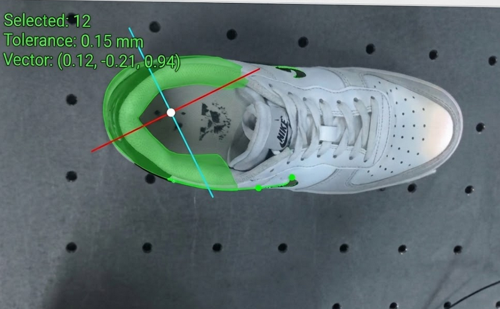
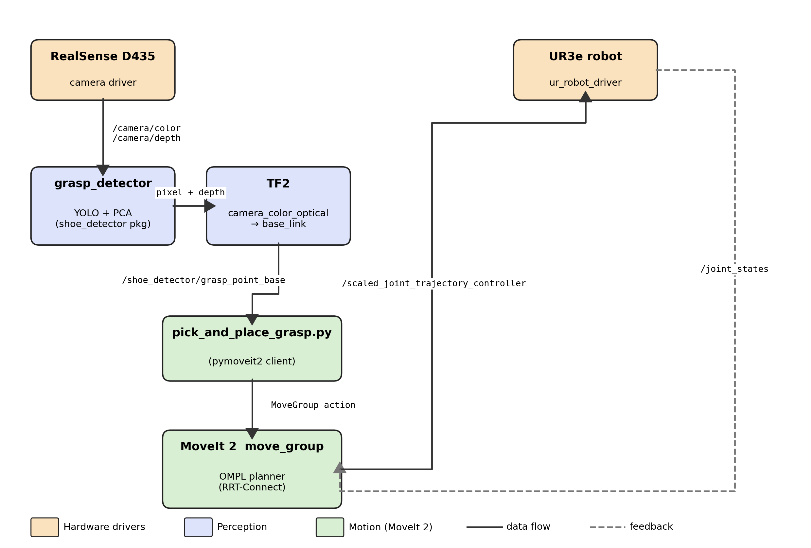

# Bin-picking robotisé — UR3e + vision 3D (ROS 2)

> Projet annuel SIGMA Clermont (2025–2026) · équipe de 6
> *English summary below.*

Un bras **UR3e** équipé d'une caméra **Intel RealSense D435** au poignet (eye-in-hand) repère une chaussure posée en vrac, calcule où la saisir, puis exécute un pick-and-place sans collision avec **MoveIt 2**, d'abord en simulation (Gazebo), puis sur le vrai robot.

<p align="center">
  
  
</p>

🎥 **Démo sur le vrai robot :** [`media/demo_ur3e.mp4`](media/demo_ur3e.mp4)
📄 **Rapport complet :** [`docs/rapport_bin_picking.pdf`](docs/rapport_bin_picking.pdf)

## Pipeline

| Étape | Ce qui est fait | Où dans le code |
|---|---|---|
| **Percevoir** | YOLOv11s-seg entraîné sur ~1 200 images annotées (Roboflow) : segmentation de la chaussure et de son trou de prise. Ajout d'images négatives et des classes « main » / « bras robot » pour éliminer les faux positifs. | `src/shoe_detector/` |
| **Localiser** | Calibration main-œil (ArUco + easy_handeye2), ACP sur le masque pour l'axe de prise, RANSAC pour retirer le plan de la table, passage pixel → repère robot. | `src/shoe_detector/shoe_detector/grasp_detector.py`, `config/` |
| **Saisir** | MoveIt 2 (RRT-Connect) : machine à états en 10 étapes, table et support caméra déclarés en obstacles. | `src/ur_sim/scripts/pick_and_place_grasp.py` |

## Contenu du dépôt

```
src/
  shoe_detector/        nœuds de perception (YOLO + calcul du point de prise), modèle entraîné
  ur_sim/               simulation Gazebo (UR3e + pince Robotiq 2F-85), scripts pick-and-place
  ur_moveit/            config MoveIt 2 du UR3e
  ur_gripper_moveit/    config MoveIt 2 du UR3e + pince
  models/               modèle Gazebo de la table de TP
config/                 calibration cinématique du UR3e, calibration main-œil, intrinsèques caméra
docs/                   rapport, architecture, commandes de lancement
media/                  vidéo de démo et figures
dependencies.repos      paquets tiers à cloner (driver UR, aruco_ros, easy_handeye2)
```

## Installation (Ubuntu 22.04 · ROS 2 Humble)

```bash
mkdir -p ~/ur3e_ws && cd ~/ur3e_ws
git clone https://github.com/jasser-bougatef/ur3e-bin-picking.git .
vcs import src < dependencies.repos        # paquets tiers
rosdep install --from-paths src -iy
pip install ultralytics
colcon build --symlink-install && source install/setup.bash
```

## Lancement sur le vrai robot

```bash
# 1. Driver UR3e (adapter l'IP du robot)
ros2 launch ur_robot_driver ur_control.launch.py ur_type:=ur3e robot_ip:=<IP_ROBOT> \
     kinematics_params_file:=$PWD/config/my_ur3e_calibration.yaml launch_rviz:=false
# 2. MoveIt 2
ros2 launch ur_moveit_config ur_moveit.launch.py ur_type:=ur3e launch_rviz:=true
# 3. Caméra + transformée main-œil
ros2 launch shoe_detector perception.launch.py
# 4. Détection du point de prise
ros2 run shoe_detector grasp_detector --ros-args \
     -p model_path:=$PWD/src/shoe_detector/models/best_kaagle_10mars.pt -p target_class:=hole -p conf_threshold:=0.5
# 5. Séquence pick-and-place
python3 src/ur_sim/scripts/pick_and_place_grasp.py
```

La procédure de calibration main-œil est détaillée dans [`docs/commandes_calibration.txt`](docs/commandes_calibration.txt).

> ⚠️ Certains scripts contiennent encore des chemins absolus de nos machines (`/home/...`) : passez le chemin du modèle en paramètre ou adaptez-le.

## Ce que j'en retiens

Notre premier modèle avait un mAP proche de 100 %… et confondait la main de l'opérateur avec une chaussure. Il a fallu refaire le dataset (images négatives, classes « main » et « bras robot ») pour le rendre fiable en conditions réelles.

## Équipe

Jasser Bougatef, Farah Ben Slimene, Abdelmounim Farouk, Yassine Bour, Julien Navet, Dina Moutih — SIGMA Clermont.

---

### English summary

Bin-picking on a **UR3e** arm with a wrist-mounted **RealSense D435**: a **YOLOv11-seg** model (~1,200 annotated images) segments the shoe and its grasp hole, **PCA** on the mask gives the grasp axis, **hand-eye calibration** maps pixels to robot coordinates, and **MoveIt 2** runs a collision-aware pick-and-place, first in Gazebo, then on the real robot. ROS 2 Humble, Python.
